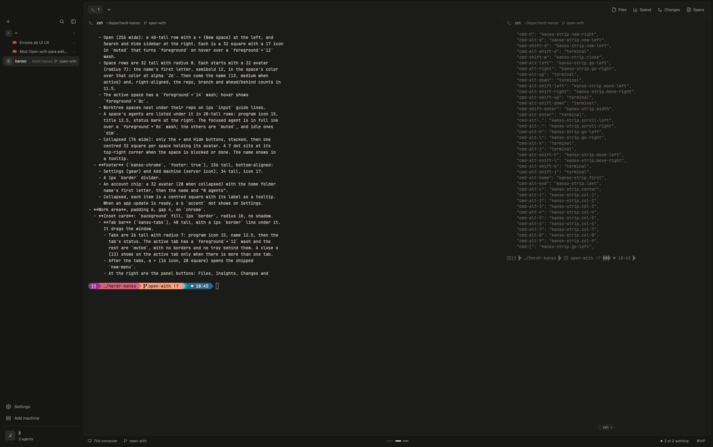

# Kanso

A quiet layout for the [Herdr](https://herdr.dev) app: warm stone greys, no
outlines, color only when an agent needs you, and nothing running that you
aren't looking at. Side panels exist only while open, and background checks
slow down when the window is behind. Panes live on an endless strip, as in
Omarchy's scrolling layout: a new one opens beside the focused one at its own
width, nothing shrinks, and the view slides to it.

| Keys | What they do |
|---|---|
| Cmd+D, Cmd+Alt+D, Cmd+Shift+D, Cmd+Alt+Shift+D | New pane right, left, below, above |
| Cmd+Alt+Arrows or H/J/K/L | Move the focus (the view glides to it) |
| Cmd+Alt+1-9, Home, End, C | Jump to a column, the first, the last; centre |
| Cmd+Alt+Shift+Arrows | Move the pane or column |
| Cmd+Shift+Enter, Cmd+Alt+Enter | Cycle column width, pane height |
| Cmd+Shift+W | Close the pane |
| Ctrl+drag a pane header | Rearrange (add Shift to stack) |
| Wheel over a header or the minimap | Slide the view |



## Install

Ask your agent: "add herdr.dev/layouts/jlopezlira/kanso". Or by hand, from a
clone of this repo:

```sh
cp kanso/layouts/kanso.json ~/.config/herdr-app/layouts/
cp kanso/layouts/kanso.png  ~/.config/herdr-app/layouts/
cp kanso/themes/*.json      ~/.config/herdr-app/themes/
cp -R kanso/mods/kanso-*    ~/.config/herdr-app/mods/
# then add the "layout:kanso" section of kanso/keys.json to ~/.config/herdr-app/keys.json
herdr-app do layout.switch --name kanso
```

`ctrl-shift-l` switches back to your previous layout. Deleting the files
removes Kanso.

## What it runs

The mods run `git` (the spaces list, Files, Changes), `sh` (the Files listing)
and `hc machine ls` (machines). They read files only inside the folders you
work in. Nothing reaches the network.

Specs (`sdd-focused`, from the minimalistic layout) and Insights are optional:
install either mod and its button appears in the tab bar.

How it is built, in enough detail to rebuild it: [kanso/RECIPE.md](kanso/RECIPE.md).

## License

Apache License 2.0. See [LICENSE](LICENSE) and [NOTICE](NOTICE).
