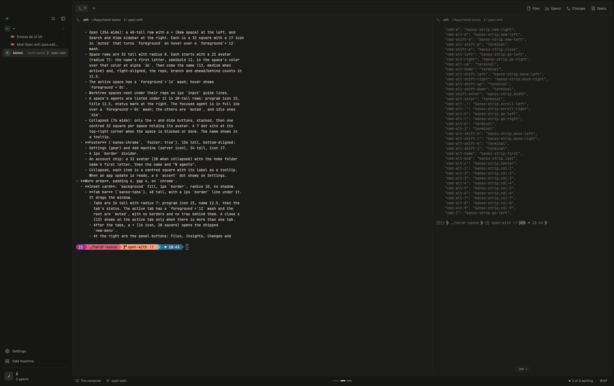

# Kanso

Kanso is a quiet Herdr layout for long days with coding agents. Warm stone
greys, no outlines, no decoration: the only text in full ink is the focused
pane's, and color appears only when an agent's state matters (working, needs
you, finished). Its second idea is that nothing you aren't looking at runs:
side panels exist only while open, and background checks slow down when the
window is behind others. The name is the Japanese principle of simplicity,
removing what is not needed.

## What you see

Left to right, then top to bottom. Sizes are px at zoom 1.

- **Sidebar**, theme `chrome` (`#161615` dark, `#e3dfd6` light).
  - **Top strip**, 48 tall: empty. It holds the macOS traffic lights (at
    `[12, 16]`) and drags the window.
  - **Spaces** (`kanso-spaces`), filling the middle.
    - Open (256 wide): a 40-tall row with a + (New space) at the left, and
      Search and Hide sidebar at the right. Each is a 32 square with a 17 icon
      in `muted` that turns `foreground` on hover over a `foreground`+`12`
      wash.
    - Space rows are 32 tall with radius 8. Each starts with a 22 avatar
      (radius 7): the name's first letter, semibold 12, in the space's color
      over that color at alpha `26`. Then come the name (13, medium when
      active) and, right-aligned, the repo, branch and ahead/behind counts in
      11.5.
    - The active space has a `foreground`+`14` wash; hover shows
      `foreground`+`0c`.
    - Worktree spaces nest under their repo on 1px `input` guide lines.
    - A space's agents are listed under it in 28-tall rows: program icon 15,
      title 12.5, status mark at the right. The focused agent is in full ink
      over a `foreground`+`0c` wash; the others are `muted`, and idle ones
      `dim`.
    - Collapsed (76 wide): only the + and Hide buttons, stacked, then one
      centred 32 square per space holding its avatar. A 7 dot sits at its
      top-right corner when the space is blocked or done. The name shows in
      a tooltip.
  - **Footer** (`kanso-chrome`, `footer: true`), 156 tall, bottom-aligned:
    - Settings (gear) and Add machine (server icon), 34 tall, icon 17.
    - A 1px `border` divider.
    - An account chip: a 32 avatar (28 when collapsed) with the home folder
      name's first letter, then the name and "N agents".
    - Collapsed, each item is a centred square with its label as a tooltip.
      When an app update is ready, a 6 `accent` dot shows on Settings.
- **Work area**, padding 6, gap 4, on `chrome`.
  - **Inset card**: `background` fill, 1px `border`, radius 10, no shadow.
    - **Tab bar** (`kanso-tabs`), 48 tall, with a 1px `border` line under it.
      It drags the window.
      - Tabs are 26 tall with radius 7: program icon 15, name 12.5, then the
        tab's status. The active tab has a `foreground`+`12` wash and the
        rest are `muted`, with no borders and no tray behind them. A close x
        (13) shows on the active tab only when there is more than one tab.
      - After the tabs, a + (16 icon, 28 square) opens the shipped
        `new-menu`.
      - At the right are the panel buttons: Files, Insights, Changes and
        Specs. They are ghost buttons 26 tall (icon 15, text 12) with a wash
        when their panel is open. Insights and Specs show only when their
        mods are installed.
    - **Panes**: the active tab, split with 1px `border` gaps and no frames.
      Each pane has a 34-tall header (`kanso-pane`, always shown):
      - Program icon 15 (75% opacity when unfocused) and the title, 12.5 in
        `foreground` and medium weight when focused, `muted` otherwise.
      - The folder (`~/...`) and branch (with a branch glyph) as plain 11.5
        text.
      - At the right, the pane's status. On hover the status gives way to
        split right, split down, zoom and close (15 icons).
      - Terminal padding is `[14, 10]`.
    - **Side panel**, at the right of the panes: 368 wide (280 to 900),
      hidden by default. It holds whichever panel is open: `kanso-files`,
      `insights`, `kanso-changes` or `sdd-focused`.
  - **Status bar** (`kanso-status`), 26 tall, text 11.5 `muted`:
    - At the left, the machine (monitor or server icon, "This computer") and
      the branch.
    - At the right, "N agent(s) need you" in `blocked` with a dot (only when
      some agent is blocked), then a dot and "X of N working" (or "N agents
      idle" / "No agents"), then the palette shortcut "⌘⇧P" with the tooltip
      "Command palette".
- **Themes**: `kanso` (dark) and `kanso-day` (light), in `themes/`.
  - Dark: background `#1b1b19`, foreground `#d8d4cb`, chrome and canvas
    `#161615`, border `#272725`, input `#353430`, muted `#949086`, dim
    `#6b6862`, accent `#a3b09a`, working `#c4b07e`, blocked `#c99189`, done
    `#98ad8f`.
  - Light: background `#f4f1eb`, foreground `#3c3934`, chrome `#e3dfd6`,
    working `#8f7d52`, blocked `#9a6e68`, done `#6d7d62`.
- **Icons**: one Lucide-style set in `mods/kanso-chrome/icons/`, every one
  with the same stroke (2 on a 24 grid, 1.4 on a 16 grid), so they read as
  one family.

## How it behaves

- **Agent status**:
  - Working: a breathing dot in `working`, a 10px glyph cycling
    `· • ● •` every 450 ms (`.frames`). It shows on the tab, in the pane
    header, on the agent row and on the status bar dot. It is never a
    spinning icon.
  - Blocked: a `blocked` dot. The pane header adds the text "Needs you",
    the status bar says "N agent(s) need you", and a collapsed space shows
    its corner dot.
  - Done: a 6 `done` dot (tab, header, corner dot).
  - Idle: a 7 ring in `idle` on agent rows, with nothing on the tab or
    header.
- **Spaces**:
  - Click a space to select it. Clicking the space you are in folds or
    unfolds its agents; the folded state is kept.
  - Drag a space to reorder it (a 2px `accent` line shows where it lands).
    Right-click opens the shipped space menu.
  - Click an agent row to focus its pane.
- **Sidebar**:
  - Hide sidebar collapses it to a fixed 76 rail whose edge cannot be
    dragged.
  - Open, the edge drags between 200 and 480. The width you leave is
    remembered and used the next time you open it.
- **Tabs**:
  - Click selects a tab, drag reorders, double-click renames, and
    right-click opens the shipped tab menu.
  - Scrolling over the bar moves one tab per mouse-wheel notch, or per
    trackpad swipe (about 40px of travel).
- **Side panels, on demand**:
  - Clicking a panel button rewrites the panel stack to hold only that
    panel's block and shows it. Clicking it again, or closing the panel any
    other way, empties the stack. Herdr then ends that mod, and its timers,
    file watches and processes stop.
  - The open panel is remembered per space and restored when you switch
    spaces.
  - Files and Changes are idle whenever they aren't the shown panel.
  - The Specs count on its button shows only while Specs is open.
- **Background**:
  - While the window is behind others, the spaces list checks git every 5 s
    instead of every 0.5 s.
  - `hc machine ls` runs every 30 s with the window in front, and every
    2 min with it behind.

## Built from

- **Layout tree** (`layouts/kanso.json`), root `row`, `titlebar: "none"`,
  `traffic_lights: [12, 16]`, `resizable: true`:
  - `sidebar` (column, `chrome`, 256 px, min 200, max 480):
    - `brand`: an empty column, 48 px, `window_drag`.
    - `sidebar-lists` holding `spaces` (block `kanso-spaces`).
    - `sidebar-footer` (block `kanso-chrome` with `{footer: true}`, 156 px).
  - `work` (column, padding 6, gap 4):
    - `inset` (`background`, border, radius 10):
      - `tabs`: block `kanso-tabs`, 48 px, `window_drag`.
      - `work-body` (row, `border` background, gap 1):
        - `main`: `{tab: "active"}` with the `kanso-pane` header (height 34)
          and no pane borders.
        - `panel`: column 368 px, hidden, holding the stack `panel-body`,
          which starts with no children.
    - `status`: block `kanso-status`, 26 px.
- **Mods**:
  - `kanso-spaces`: spaces, agents (`agents.js`), git per space via `exec`,
    machines via `hc machine ls`.
  - `kanso-tabs`: tabs, panel buttons and the on-demand panel mount via
    `layout.set`.
  - `kanso-pane`: pane header.
  - `kanso-chrome`: sidebar footer, plus the icon set.
  - `kanso-status`: status bar.
  - `kanso-files`: lazy file tree via `sh`, git status marks.
  - `kanso-changes`: git diff and commit.
  - All are derived from Herdr's shipped mods (Apache-2.0) through the 0OZ
    and minimalistic forks, and all use `"place": "none"`.
- **Optional mods it can show, not included**: `sdd-focused` (Specs, by José
  Gutiérrez, from the minimalistic layout) and `insights` (cost analytics).
  When either is in `mods/`, its button appears.
- **Herdr functions**: `spaces`, `panes`, `agents`, `terminals`, `machines`,
  `layout`, `theme`, `shared`/`setShared`, `window`, `exec`, `hc`,
  `watchFolder`, `readTextFile`, `openOverlay`, `run`, `home`, `appHome`,
  `updates`.
- **Commands**: `layout.set`, `layout.resize`, `space.*`, `tab.*`, `pane.*`,
  `app.settings`, `app.palette`, `mod.open` (`picker`, `machine-add`).
- **Shipped overlays used**: `menu`, `new-menu`, `picker`, `machine-add`.
- **Programs run**: `git` (spaces, Files, Changes), `sh` (Files listing) and
  `hc` (machines). Nothing reaches the network.

## Watch out

- Never use `.spin()` for a busy state. It redraws the whole window about
  30 times a second while any agent works, and every redraw repaints every
  visible terminal. Use `.frames` with a slow period.
- A block stays alive while it is in the layout, even hidden. On-demand
  panels must be removed from the tree (`layout.set`), not only hidden.
  `kanso-tabs` reconciles: hidden with a child unmounts it, shown with none
  mounts the remembered panel. It waits up to 1 s for its own `layout.set`
  to land before reading the state as a choice.
- `layout.set` only works on a personal layout. Kanso is one once copied in,
  but the shipped `main` is not.
- The collapsed rail must be at least 76 wide on macOS, or the traffic
  lights overlap the tab bar. Its non-resizable state lives on the root row
  (`resizable`) together with the sidebar's `min`; `kanso-spaces` sets both
  with `layout.set` when you fold or open the sidebar, and once at start.
- Read `panes()`, `spaces()` and `layout()` once per render. Each read copies
  the whole list.
- Keep one-time fixes (`kanso.row`) in `init`, never in `render`.
- The macOS window layout (traffic lights, the empty top strip) assumes
  `titlebar: "none"`.
- Mod names are prefixed `kanso-`, so they can sit beside the minimalistic
  layout's `mn-*` mods.

## Done when

- `herdr-app check` passes for all seven `kanso-*` mods, and
  `herdr-app status` shows no errors after `layout.switch {name: "kanso"}`.
- With no panel open, `panel-body` in the layout file has no children. After
  clicking Files it holds exactly one `files` block, and closing it empties
  it again.
- With the panel closed, no process started by Files, Changes or Insights is
  running.
- A working agent shows a breathing dot (not a spinner) on its tab, header
  and agent row. A blocked one shows "Needs you" in its header and in the
  status bar.
- Collapsed, the sidebar is 76 wide, its edge does not drag, and the traffic
  lights sit inside it. Opened, it drags between 200 and 480 and reopens at
  the width you left.
- One trackpad swipe over the tab bar moves exactly one tab.
